<div align="center">

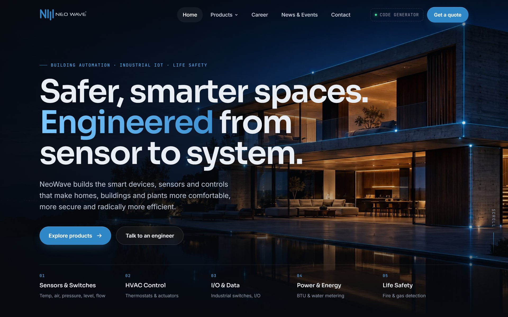

# NeoWave — Website & Product Code Generator

**The redesigned website for NeoWave, a building-automation and industrial IoT manufacturer, with a
database-backed product code generator and its own admin.**

[](https://neowave-site.vercel.app)
[](#deployment)


[Live site](https://neowave-site.vercel.app) ·
[Code generator](https://neowave-site.vercel.app/generator) ·
[Products](https://neowave-site.vercel.app/products) ·
[Admin](https://neowave-site.vercel.app/admin)

</div>

---

## Contents

- [Overview](#overview)
- [Screenshots](#screenshots)
- [Features](#features)
- [Architecture](#architecture)
- [Tech stack](#tech-stack)
- [Project structure](#project-structure)
- [Getting started](#getting-started)
- [Build pipeline](#build-pipeline)
- [Deployment](#deployment)
- [Configuration](#configuration)
- [Security](#security)
- [Performance and SEO](#performance-and-seo)

## Overview

NeoWave makes smart devices, sensors and controls for homes, buildings and industrial plants: room sensors,
smart thermostats, damper actuators, managed industrial switches, BTU and water meters, fire alarm systems and gas
detection. This repository is a full rebuild of its website. It started from an audit of the old WordPress site and
covers design, motion, AI-generated imagery, the product code generator, its database and admin, and hosting.

<div align="center">

| 9 | 60 | 82 | 35 | 460 |
| :---: | :---: | :---: | :---: | :---: |
| public pages | devices in the catalog | datasheets & manuals | configurable models | ordering options |

</div>

## Screenshots

<table>
  <tr>
    <td width="50%">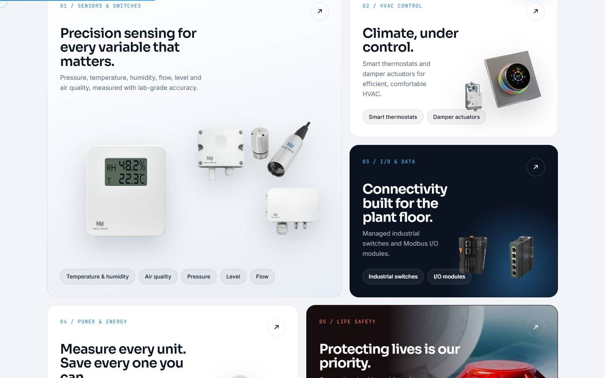<br><sub><b>Home</b> · five product families with real product cut-outs</sub></td>
    <td width="50%">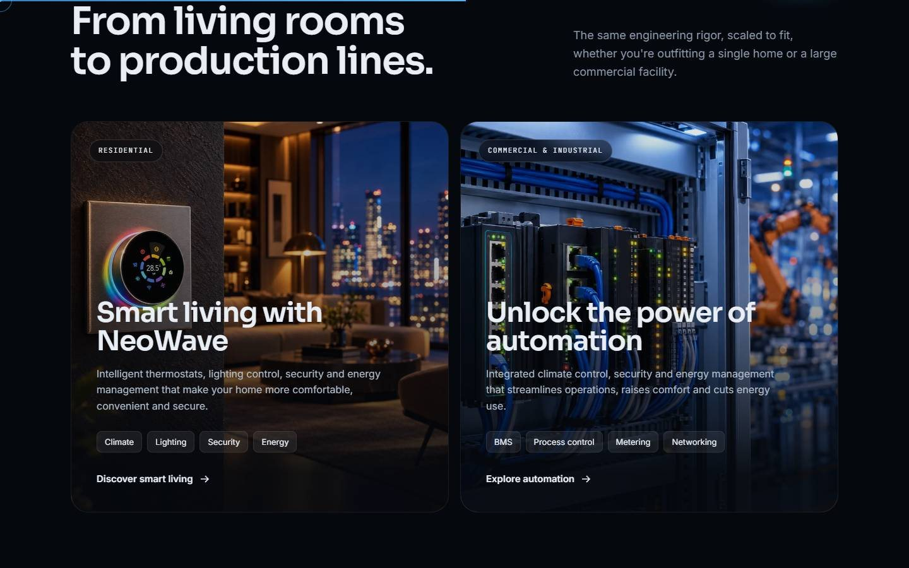<br><sub><b>Home</b> · residential and industrial solutions</sub></td>
  </tr>
  <tr>
    <td>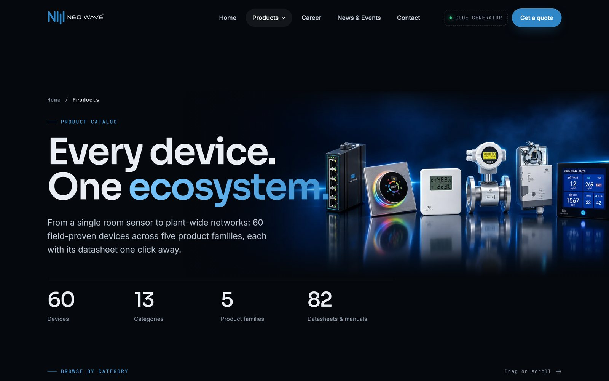<br><sub><b>Products</b> · 60 devices in 13 categories, search and filters</sub></td>
    <td>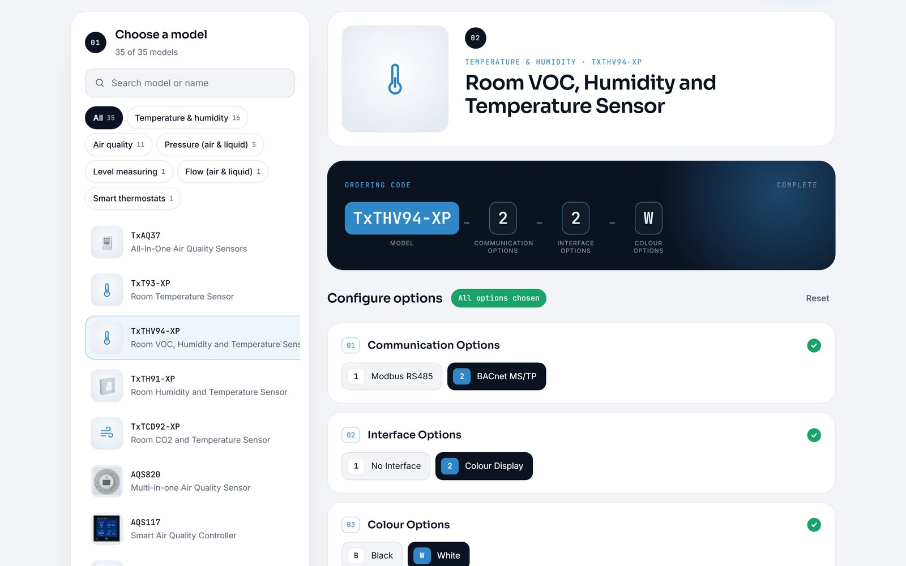<br><sub><b>Code generator</b> · each option fills its segment of the ordering code live</sub></td>
  </tr>
  <tr>
    <td>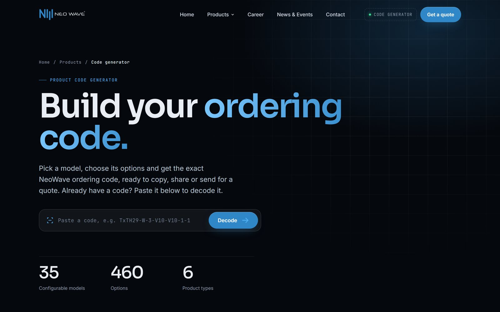<br><sub><b>Code generator</b> · paste any ordering code to decode it</sub></td>
    <td>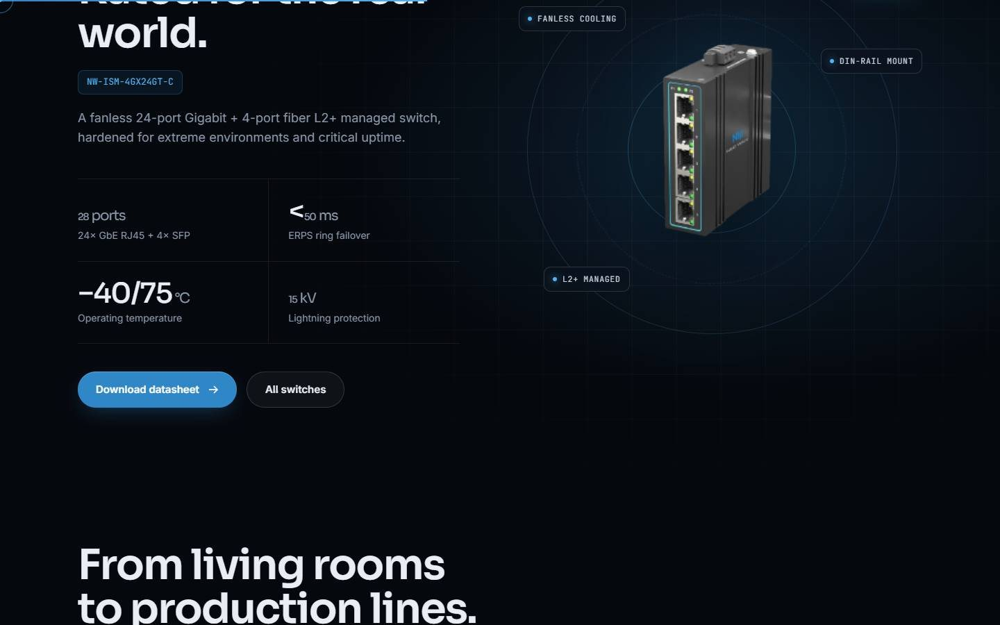<br><sub><b>Home</b> · featured switch with real specifications</sub></td>
  </tr>
  <tr>
    <td>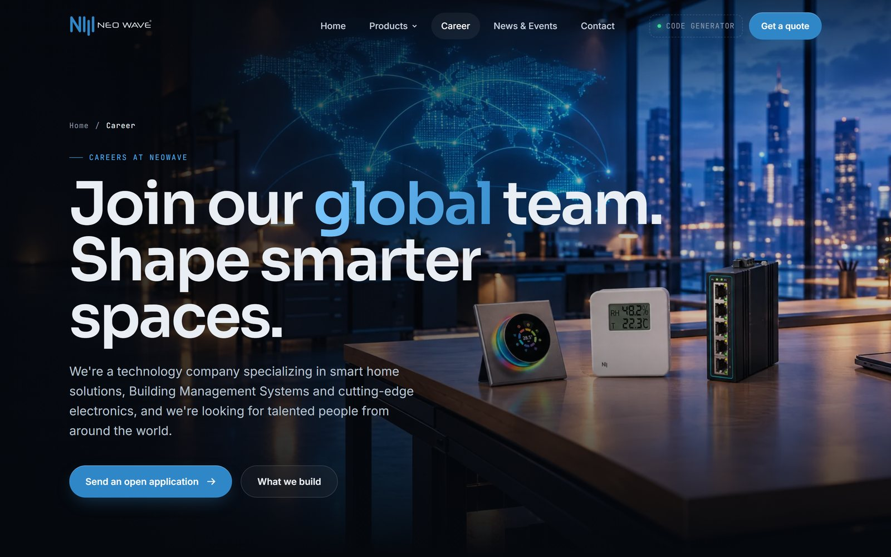<br><sub><b>Career</b> · AI-generated video loop built from the real products</sub></td>
    <td>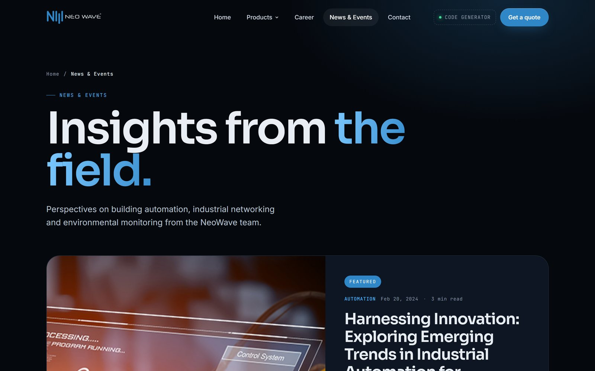<br><sub><b>News & events</b> · featured article and journal</sub></td>
  </tr>
  <tr>
    <td>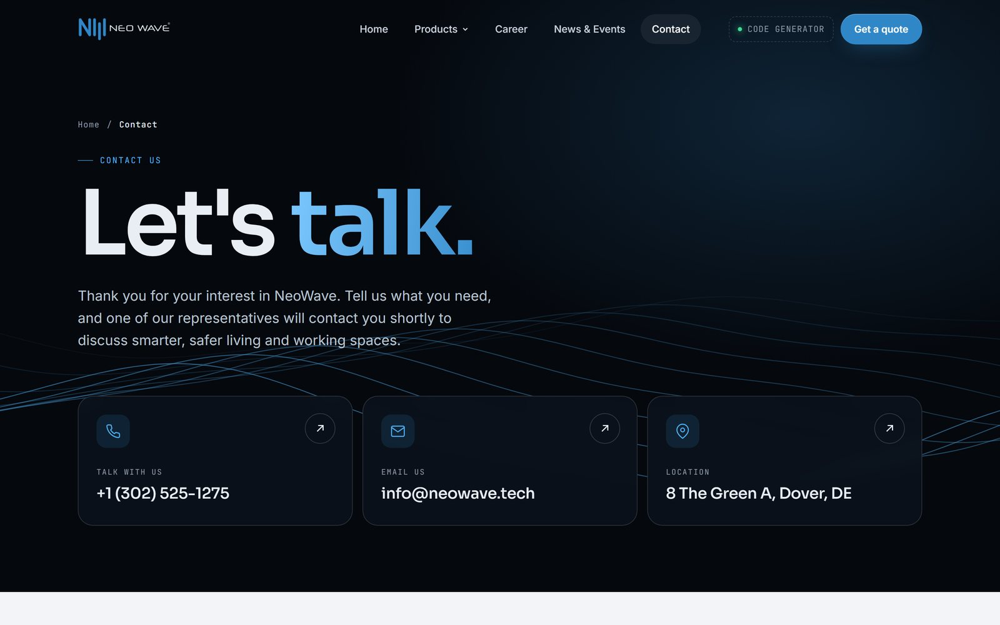<br><sub><b>Contact</b> · topic-based form, details and map</sub></td>
    <td></td>
  </tr>
</table>

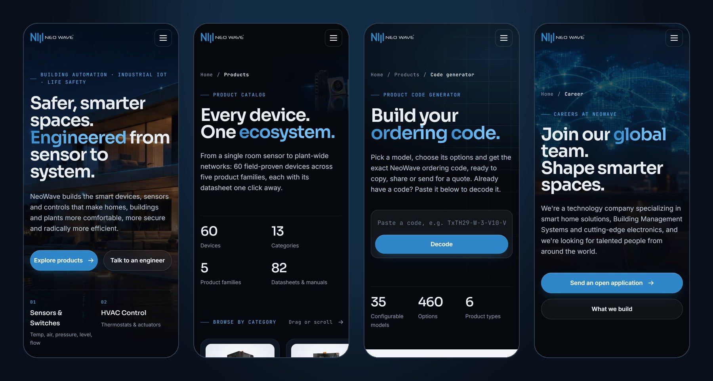
<div align="center"><sub>Every page is designed for phones too</sub></div>

## Features

### Website
- **Editorial motion system:** preloader, Lenis smooth scrolling, line-masked headline reveals, copy that highlights
  word by word as you scroll, parallax, 3D tilt cards with a spotlight, magnetic buttons, a custom cursor, a marquee
  whose speed follows the scroll, and interactive SVG waves. Hover effects use individual transform properties so
  they never fight the scroll animations.
- **AI-generated imagery from the real products:** ten scenes and two seamless 1080p video loops, generated with
  NeoWave's real product photos as reference, so the devices in every scene are the real ones.
- **Products catalog:** 60 devices across five families and 13 categories, each with its datasheet or manual one click
  away, with category filters, search and a draggable category rail.
- **Career:** open-application form that prepares the email for the applicant. **News:** three articles with a table
  of contents and reading progress. **Contact:** topic-based form, pre-filled when a visitor arrives from the
  generator with a code.
- **Clean URLs** (`/products`, not `/products.html`), a branded 404 page, and Vercel Web Analytics on every public
  page.

### Product code generator
- Pick a model, narrow the list by product type and feature, and choose each option while the ordering code
  assembles itself segment by segment.
- **Decode:** paste an existing code and the generator works out the model (longest matching base code) and every
  option.
- **Share and quote:** every configuration has its own link, a finished code can go straight into a quote request,
  and recently built codes are remembered on the device.
- Data comes from the latest published snapshot, with a static fallback if the API is unavailable.

### Admin (`/admin`)
- Create and edit models, drag option groups into order, paste a whole list of options at once, and see the code
  preview update live.
- Upload product photos, manage the feature filters, and review an activity log of who changed what.
- Team accounts with one-time passwords and self-service password changes.
- Two people editing the same model can't silently overwrite each other (optimistic locking).
- **Publish to site** saves a snapshot that the public generator serves within about a minute, with no redeploy.

## Architecture

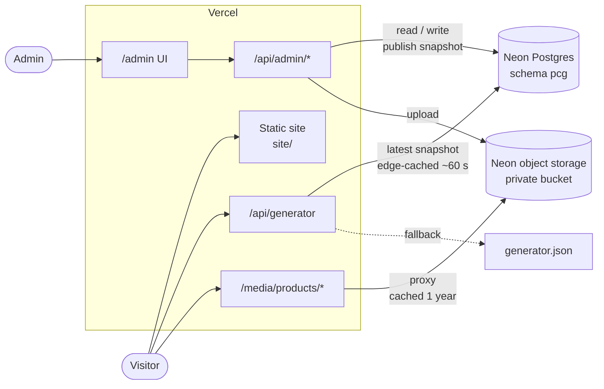

- **Static pages.** `site/index.html` is hand-written and acts as the template: `gen/chrome.py` copies its head, nav,
  CTA and footer into every generated page.
- **Three Vercel functions.** `api/admin.js` is one router for every admin route, `api/generator.js` serves the
  published data, and `api/media.js` streams product photos from the private bucket.
- **Database.** Schema `pcg`: families → product types → features → models → ordered option groups → options, plus
  admin users, sign-in attempts, the audit log and published snapshots.
- **Ordering code** = model base code + `-` + each option group's chosen code, in order.

## Tech stack

| Layer | Tools |
| --- | --- |
| Front end | HTML, CSS, vanilla JavaScript, GSAP 3 + ScrollTrigger, Lenis |
| Back end | Node.js 22 serverless functions on Vercel, `pg`, AWS SDK v3 (S3 client) |
| Data | Neon Postgres (schema `pcg`), Neon object storage (S3-compatible) |
| Build | Python 3.12 page generators, Node build step for analytics |
| Hosting | Vercel (static + functions, clean URLs, Web Analytics), auto-deploy from GitHub |
| Imagery | AI image and video generation, using real product photos as reference |

## Project structure

```
.
├── site/                 the static website Vercel serves
│   ├── index.html        hand-written homepage, also the template for every page
│   ├── *.html            generated pages (products, generator, career, news, contact, 404)
│   ├── admin/            admin UI (HTML, CSS, JS)
│   └── assets/           css/, js/, img/, video/, data/
├── api/                  Vercel functions: admin.js, generator.js, media.js
├── lib/                  server code: db, auth, generator data logic, photo storage, http helpers
├── scripts/              vercel-build.mjs (runs on every Vercel build)
├── gen/                  Python page generators, data and local tools (not deployed)
├── docs/images/          README screenshots
├── dev-server.mjs        local stand-in for Vercel
└── vercel.json           routes, rewrites and security headers
```

## Getting started

Requirements: **Node 22** and **Python 3.12**.

```bash
npm install
bash gen/build_all.sh        # regenerate every page and cache-bust CSS/JS
node dev-server.mjs          # http://localhost:5530  (admin at /admin)
```

The dev server runs the same functions, headers and rewrites as Vercel. It reads its database and storage settings
from `gen/.env` (see [Configuration](#configuration)).

## Build pipeline

Run `bash gen/build_all.sh` after changing a build script, the homepage, CSS or JS.

| Step | Builds |
| --- | --- |
| `gen/build_products.py` | `products.html` from `gen/catalog.json` |
| `gen/build_career.py` | `career.html` |
| `gen/build_pages.py` | `news.html`, the three articles, `contact.html` |
| `gen/build_generator.py` | `generator.html` |
| `gen/build_seo.py` | `404.html`, `robots.txt`, `sitemap.xml` (`SITE_URL` lives here) |
| `gen/version_assets.py` | `?v=` cache-busting hashes, clean-URL links, the admin photo list |

`bash gen/build_all.sh --db` also refreshes the generator's static fallback from the database first.

## Deployment

Every push to `main` deploys to production on Vercel automatically.

> [!IMPORTANT]
> Vercel serves `site/` exactly as committed; it doesn't run the Python generators. Run `bash gen/build_all.sh`
> and commit the regenerated `site/` files before you push.

Generator data doesn't need a deploy at all: admins change it at `/admin` and press **Publish to site**.

To deploy by hand: `npx vercel deploy --prod`.

## Configuration

Secrets are never committed. Locally they live in `gen/.env` (git-ignored); in production they are Vercel
environment variables.

| Variable | Used for |
| --- | --- |
| `DATABASE_URL` | Postgres connection as the restricted `pcg_app` role |
| `SESSION_SECRET` | signs admin session cookies |
| `NEON_S3_ENDPOINT` · `NEON_S3_KEY_ID` · `NEON_S3_SECRET` · `NEON_S3_REGION` · `NEON_S3_BUCKET` | product photo storage |

## Security

- The functions connect as `pcg_app`, a database role that can only use schema `pcg`.
- Admin passwords are hashed with scrypt. Sessions are signed `HttpOnly`, `Secure`, `SameSite=Strict` cookies that
  expire after 8 hours, and changing a password signs out the user's other sessions.
- Failed sign-ins are rate-limited (8 per 15 minutes per IP and per account).
- Admin API calls must carry a custom request header, which blocks cross-site requests.
- `/admin` is served with a strict Content-Security-Policy, `X-Frame-Options: DENY` and `noindex`.
- The photo bucket is private; photos are only reachable through the `/media` proxy.

## Performance and SEO

- Videos below the fold load only when they scroll near the viewport.
- CSS and JS carry content hashes, so a deploy never serves stale files.
- Product photos and media are served with long-lived cache headers.
- Every page has a meta description and Open Graph tags, and images have alt text.
- `robots.txt` keeps `/admin` and `/api` out of search engines; `sitemap.xml` lists every public page.

More operational detail (admins, publishing, photo uploads, analytics): [gen/README.md](gen/README.md).

---

<div align="center"><sub>Product names, photos and data © NeoWave.</sub></div>
